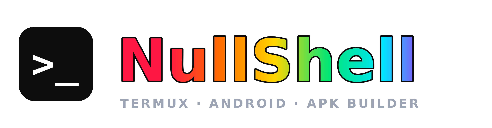
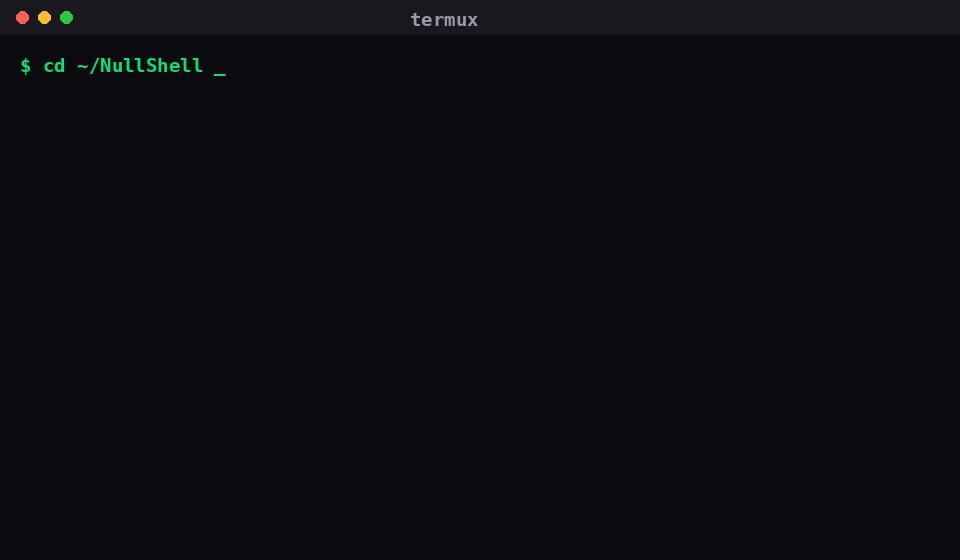

<div align="center">



# 🐚 NullShell

### ⚡ Build Android APKs **and** pure Java apps — right from your terminal.

**No Android Studio. No Gradle. No PC. Just one command.** 🚀




</div>

---

## 👤 Owner

<div align="center">

**Hari Jadhav Ji**

| 🌐 | Handle | Link |
|:--:|:--|:--|
| 💬 | Telegram | [`nullkrishn`](https://t.me/nullkrishn) |
| 🐙 | GitHub | [`nullkrishn3`](https://github.com/nullkrishn3) |
| 📸 | Instagram | [`ur_.krishn_02`](https://instagram.com/ur_.krishn._02) |

</div>

> 🛡️ NullShell is created & owned by **Hari Jadhav Ji**. The owner block is **tamper-protected**.

---

## 📑 Table of Contents

- [📖 What is NullShell?](#-what-is-nullshell)
- [📦 Requirements](#-requirements)
- [🚀 Installation](#-installation)
- [⚡ Quick Start](#-quick-start)
- [🧾 Full Command Reference](#-full-command-reference)
- [🔧 Environment Variables](#-environment-variables)
- [🧩 Build Modes](#-build-modes)
- [✅ Do's and ❌ Don'ts](#-dos-and--donts)
- [⚙️ Config File](#️-config-file)
- [📁 Project Layouts](#-project-layouts)
- [📚 Libraries & Native Code](#-libraries--native-code)
- [🔬 How It Works](#-how-it-works)
- [📱 Install on Any Android](#-install-on-any-android)
- [🛡️ Tamper Protection](#️-tamper-protection)
- [🧯 Troubleshooting](#-troubleshooting)
- [📜 License](#-license)

---

## 📖 What is NullShell?

NullShell is a **single-command builder** that turns a folder of code into a finished app.

Point it at a folder and it builds:

- 🟢 **Android APK** — from Java + `AndroidManifest.xml` → a signed, installable `.apk`
- 🟠 **Pure Java (JVM)** — from plain `.java` files with `main()` → a runnable `.jar`

It sets up its own toolchain, handles resources, libraries and native code, does
multi-dex, and signs the APK (v1 + v2 + v3).

```bash
cd ~/NullShell
NullShell        # 🎉 builds everything inside
```

---

## 📦 Requirements

| Platform | Needs |
|:--|:--|
| 🟢 **Termux** | Termux app (F-Droid). NullShell installs the rest itself. |
| 🐧 **Linux** | `bash`, `openjdk-17-jdk`, Android **build-tools** (`aapt2`, `apksigner`, `d8`), `zip` |
| 🍎 **macOS** | `bash`, JDK 17, Android build-tools, `zip` |
| 🪟 **Windows** | Use **WSL2** or **Docker** (recommended) |
| 🐳 **Docker** | Docker only — the image bundles everything |

---

## 🚀 Installation

### 🟢 Termux (Android — recommended)

```bash
pkg update && pkg upgrade -y
pkg install -y git
termux-setup-storage

git clone https://github.com/nullkrishn3/NullShell.git
cd NullShell
bash install.sh          # installs tools + android.jar + keystore, and the NullShell command
```

### 🐧 Linux / 🍎 macOS

```bash
git clone https://github.com/nullkrishn3/NullShell.git
cd NullShell

# 1) Java
sudo apt install -y openjdk-17-jdk-headless zip unzip    # Debian/Ubuntu
# brew install openjdk@17                                 # macOS

# 2) Android build-tools (aapt2, apksigner, d8) — install the Android command-line tools
#    and add  $ANDROID_SDK_ROOT/build-tools/<ver>  to PATH

# 3) Make it a command
bash NullShell --install       # installs to ~/.local/bin/NullShell
```

### 🐳 Docker (easiest on any OS)

```bash
git clone https://github.com/nullkrishn3/NullShell.git
cd NullShell

docker build -t nullshell .

# build everything in ./projects
mkdir -p projects && cp -r app Java projects/ 2>/dev/null
docker run --rm -v "$PWD/projects:/work" nullshell --all /work
```

Or with compose:

```bash
docker compose run --rm nullshell --all /work
```

### 🪟 Windows

**Option A — WSL2 (recommended):**
```powershell
wsl --install          # then inside Ubuntu:
sudo apt update && sudo apt install -y openjdk-17-jdk zip unzip
git clone https://github.com/nullkrishn3/NullShell.git
cd NullShell && bash NullShell --install
```

**Option B — Docker Desktop:** use the Docker steps above.

---

## ⚡ Quick Start

```bash
# Android app
cd app
NullShell                        # -> app/NullShell/<AppName>.apk

# Pure Java app
cd ../Java
NullShell                        # -> Java/NullShell/app.jar
java -jar NullShell/app.jar      # run it
```

Or build **everything** from the repo root with one command:

```bash
cd NullShell
NullShell                        # builds app/ AND Java/ automatically
```

---

## 🧾 Full Command Reference

| Command | Description |
|:--|:--|
| `NullShell` | 🔎 Auto-detect and build the current folder (or every sub-project) |
| `NullShell <dir>` | 📂 Build the given folder |
| `NullShell --apk [dir]` | 🤖 Force **Android APK** build |
| `NullShell --jar [dir]` | ☕ Force **Pure Java** `.jar` build |
| `NullShell --run [dir]` | ▶️ Build Java **and run it** |
| `NullShell --all [dir]` | 🧱 Build **every** sub-project in the folder |
| `NullShell --setup` | 🧰 Install tools + keystore only (no build) |
| `NullShell --install` | 🌐 Install as the global `NullShell` / `nullshell` command |
| `NullShell --clean [dir]` | 🧹 Remove `.nullshell-build` and `NullShell/` |
| `NullShell --owner` | 👤 Show owner details |
| `NullShell --version` | 🏷️ Show version |
| `NullShell --help` | ❓ Show help |

---

## 🔧 Environment Variables

| Variable | Meaning | Default |
|:--|:--|:--|
| `NULLSHELL_MIN_SDK` | Override `minSdkVersion` | `21` |
| `NULLSHELL_TARGET_SDK` | Override `targetSdkVersion` | `30` |
| `NULLSHELL_KS` | Custom keystore path | `~/.nullshell/nullshell.keystore` |
| `NULLSHELL_KS_PASS` | Keystore password | `nullshell123` |
| `NULLSHELL_KS_ALIAS` | Key alias | `nullshellkey` |

```bash
NULLSHELL_TARGET_SDK=34 NullShell
```

---

## 🧩 Build Modes

| Mode | Trigger | Output |
|:--|:--|:--|
| 🟢 **Android APK** | folder has `AndroidManifest.xml` | signed `.apk` |
| 🟠 **Pure Java (JVM)** | `.java` with `public static void main(...)` | runnable `.jar` (+ `run.sh`) |

---

## ✅ Do's and ❌ Don'ts

**✅ Do**

- ✅ Put **all** your code in **one folder** and run `NullShell` inside it.
- ✅ Keep the `AndroidManifest.xml` at the **project root** (or `app/src/main/`).
- ✅ Put libraries (`androidx` etc.) as **`.jar` files in `libs/`**.
- ✅ Run `NullShell` from the **same folder** where you want the APK/JAR.
- ✅ Build **before** running: `NullShell` → then `java -jar NullShell/app.jar` (or use `--run`).
- ✅ Set `minSdk=21`, `targetSdk=30` for the widest device support.

**❌ Don't**

- ❌ Don't run `bash NullShell` on the **folder** — that gives *"Is a directory"*.
  Use `bash NullShell/nullshell` or `bash NullShell/install.sh`.
- ❌ Don't run `java -jar NullShell/app.jar` **before building** — the file won't exist yet.
- ❌ Don't expect Gradle dependency resolution — NullShell doesn't download libraries.
- ❌ Don't edit the **owner block** — the tool will block itself (tamper protection).
- ❌ Don't run the JAR from a different folder than where it was built.

---

## ⚙️ Config File

Create `nullshell.conf` in your project root:

```ini
# NullShell config
MIN_SDK=21
TARGET_SDK=30
APP_NAME=MyApp
JAVAC_RELEASE=          # blank = auto (9, 8, 11, 17)
SKIP_SIGN=              # 1 = produce unsigned APK

# signing (optional)
KEYSTORE=/sdcard/my.keystore
KS_PASS=mypassword
KS_ALIAS=mykey
```

---

## 📁 Project Layouts

**Android — flat (AIDE / manual)**
```
AndroidManifest.xml   src/   res/   assets/   libs/   lib/
```

**Android — Android Studio style**
```
app/src/main/AndroidManifest.xml
app/src/main/java/...    app/src/main/res/...    app/src/main/assets/...
app/libs/*.jar
```

**Pure Java**
```
Any .java in the folder / src/ / java/ / Java/   (with main())
```

---

## 📚 Libraries & Native Code

```
MyApp/
├── AndroidManifest.xml
├── src/  (or app/src/main/java)
├── res/  (or app/src/main/res)
├── libs/
│   └── appcompat-1.6.1.jar      # jars -> classpath + dex
└── lib/
    └── arm64-v8a/libnative.so    # native -> packed into APK
```

- 📚 `libs/*.jar` → added to the `javac` classpath **and** dexed by `d8`.
- 🧱 `lib/<abi>/*.so` (and `jniLibs/`) → packed at `lib/<abi>/` inside the APK.
- ⚠️ NullShell has **no Gradle resolver** — provide library jars yourself.

---

## 🔬 How It Works

```
🟢 Android :  aapt2 compile → aapt2 link → javac → d8 (multi-dex) → zip + zipalign → apksigner
🟠 Java    :  javac → detect main() → jar cfm → runnable .jar (+ run.sh)
```

---

## 📱 Install on Any Android

Newer Android **blocks** installing APKs whose `targetSdkVersion` is too old
(Android 14 → needs ≥ 23, Android 15/16/17 → needs ≥ 24).

NullShell **forces `minSdkVersion=21` and `targetSdkVersion=30`** on a temporary copy
of the manifest (your file is never modified), so the APK installs on **Android 5 → 16+**.

| Android | Minimum targetSdk to install |
|:--|:--|
| Android 14 | 23 |
| Android 15 | 24 |
| Android 16 / 17 | 24 |

---

## 🛡️ Tamper Protection

The owner identity block is sealed with a **SHA-256** hash, verified at every startup.
Editing the owner name / handles → **🚨 TAMPER DETECTED** and the tool blocks itself.

---

## 🧯 Troubleshooting

| 😖 Error | ✅ Fix |
|:--|:--|
| `Is a directory` | You ran `bash NullShell` on a **folder**. Run `bash NullShell/nullshell` or `bash NullShell/install.sh`. |
| `Unable to access jarfile` | Build first (`NullShell`), then `java -jar NullShell/app.jar`, from the **same** folder. |
| `package ... does not exist` | A library is missing → put its `.jar` in `libs/`. |
| `App not installed` | Uninstall the old version first (different signature), or tap **Install anyway**. |
| `d8 fail` | A library jar was built with too new a Java version — use a Java 8 jar. |
| `command not found: NullShell` | Run `bash NullShell/install.sh` (or `bash nullshell --install`). |

---

## 📜 License

**MIT License** — created & owned by **Hari Jadhav Ji**. Please keep the credits intact. 🙏

---

<div align="center">

**Made with ❤️ by Hari Jadhav Ji**

💬 [Telegram](https://t.me/nullkrishn) · 🐙 [GitHub](https://github.com/nullkrishn3) · 📸 [Instagram](https://instagram.com/ur_.krishn._02)


⭐ If NullShell helped you, give the repo a star!

</div>
